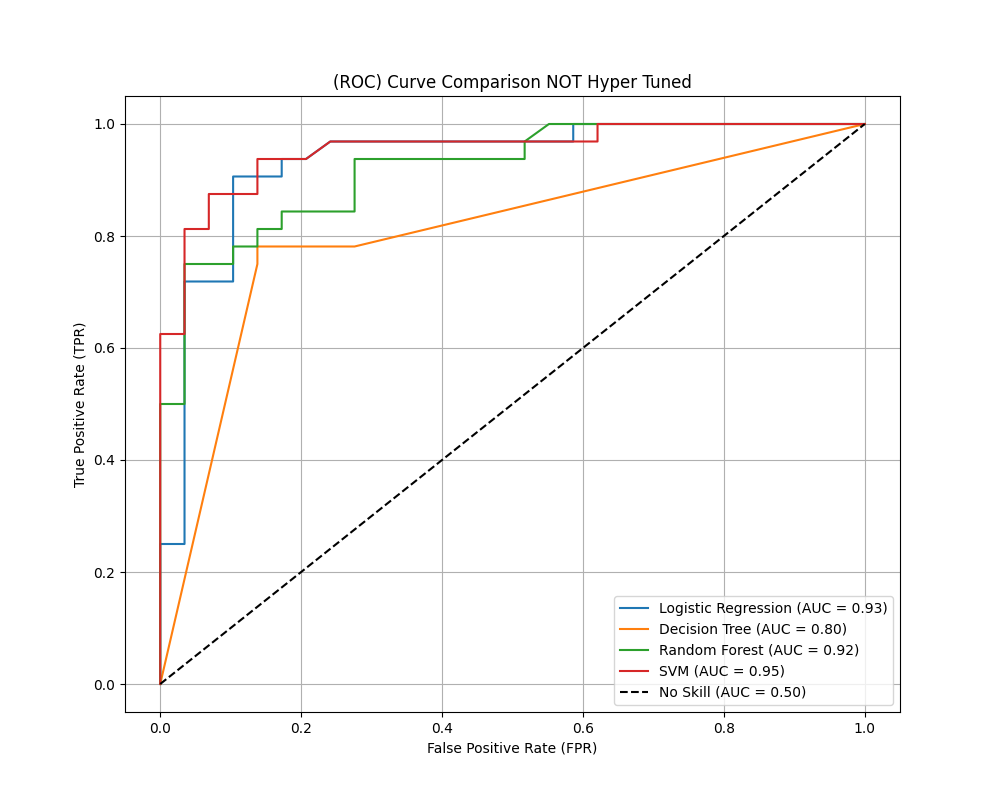
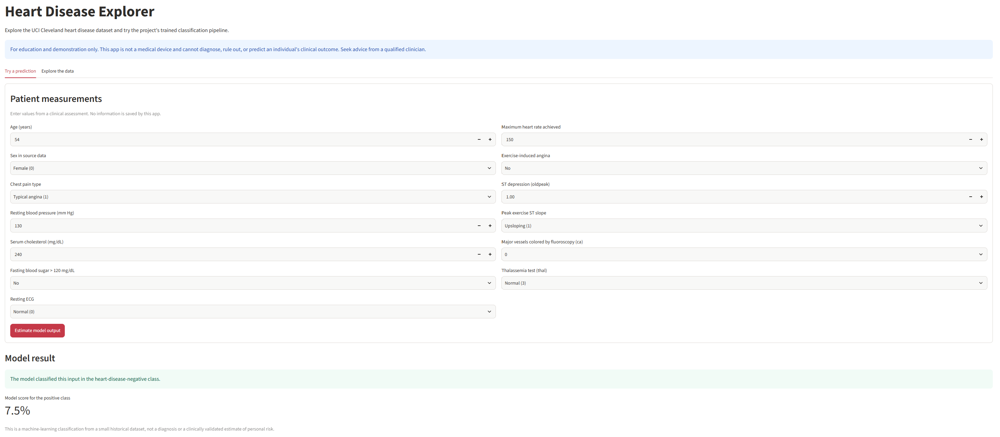
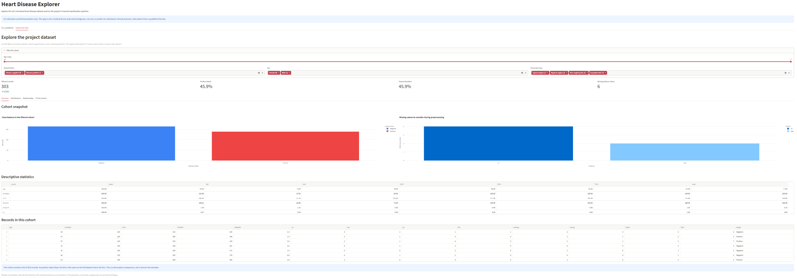
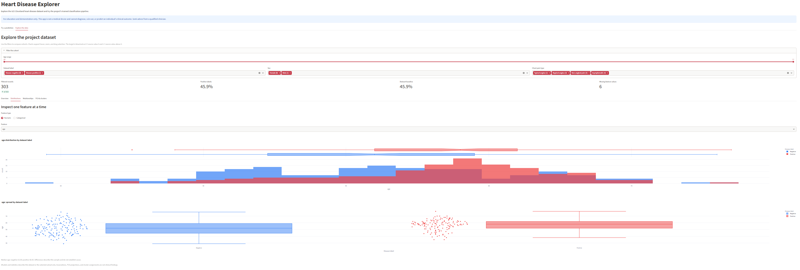
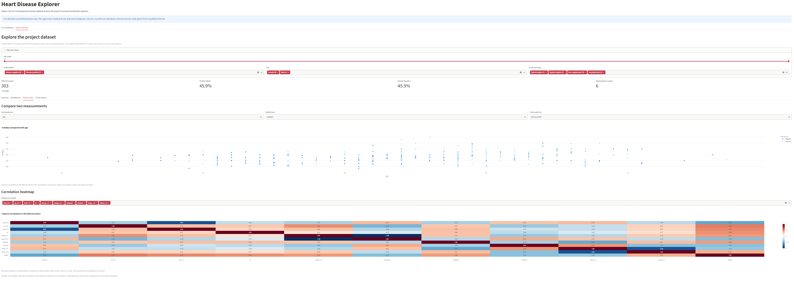
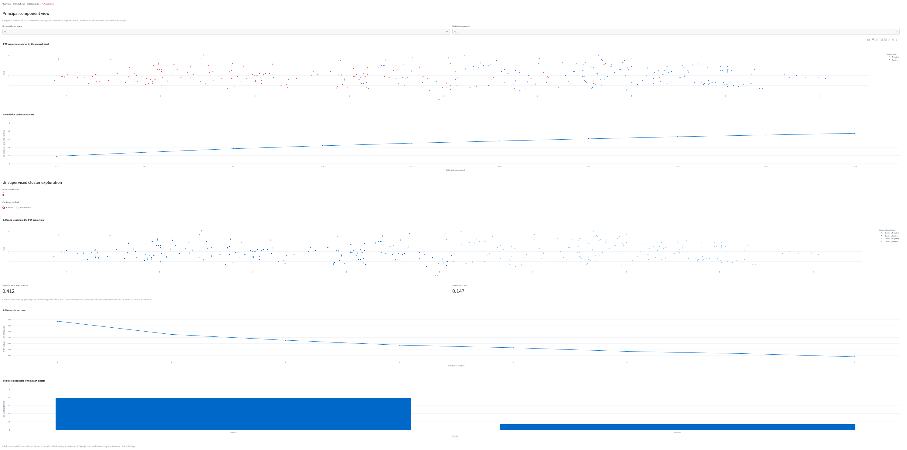

<div align="center">

# Heart Disease Analysis & Prediction

An end-to-end machine-learning project for exploring the UCI Heart Disease dataset, comparing classifiers, and interacting with a saved prediction pipeline.


</div>

> **Educational project only.** This software is not a medical device and must not be used to diagnose, treat, or rule out heart disease. Model outputs are not clinical risk estimates. Consult a qualified healthcare professional for medical questions.

## Contents

- [Project overview](#project-overview)
- [Dataset](#dataset)
- [Project workflow](#project-workflow)
- [Results](#results)
- [Interactive Streamlit app](#interactive-streamlit-app)
- [Deploy to Streamlit Community Cloud](#deploy-to-streamlit-community-cloud)
- [Installation and launch](#installation-and-launch)
- [Optional Ngrok tunnel](#optional-ngrok-tunnel)
- [Repository structure](#repository-structure)
- [Re-running the notebooks](#re-running-the-notebooks)
- [Reproducibility and limitations](#reproducibility-and-limitations)
- [License and data citation](#license-and-data-citation)

## Project overview

This repository contains the stages of a heart-disease classification project:

1. Prepare and explore the dataset, including missing-value handling, encoding, and scaling.
2. Reduce dimensionality with Principal Component Analysis (PCA).
3. Rank and select features using model-based importance, recursive feature elimination, and Chi-Square analysis.
4. Train and compare Logistic Regression, Decision Tree, Random Forest, and Support Vector Machine (SVM) classifiers.
5. Explore K-Means and hierarchical clustering.
6. Tune model hyperparameters and save a preprocessing-plus-classification pipeline.
7. Use a Streamlit app to explore the dataset and request an educational model prediction.

The analysis is organized into numbered Jupyter notebooks in `notebooks/`. Intermediate datasets, serialized models, and evaluation results are kept in their own folders.

## Dataset

The project uses the Cleveland subset of the [UCI Heart Disease dataset](https://doi.org/10.24432/C52P4X). The raw files in this repository contain **303 records** and **13 input features**. The target column is named `num`; the app and saved classification pipeline use a binary label:

| Binary label | Source `num` value | App wording |
|---|---:|---|
| `0` | `0` | Negative |
| `1` | Greater than `0` | Positive |

The raw features include age, sex, chest-pain type, resting blood pressure, cholesterol, fasting blood sugar, resting ECG, maximum heart rate, exercise-induced angina, ST depression (`oldpeak`), ST slope, vessels seen by fluoroscopy (`ca`), and thalassemia result (`thal`).

The raw feature file has missing entries in `ca` and `thal`. The saved prediction pipeline includes imputation as part of preprocessing. Dataset-level observations and missingness are also shown in the app.

### Data files

| File | Contents |
|---|---|
| [`heart_disease_features_Raw.csv`](data/heart_disease_features_Raw.csv) | 303 rows of the 13 original input features |
| [`heart_disease_target_Raw.csv`](data/heart_disease_target_Raw.csv) | Original `num` target values |
| [`heart_disease.csv`](data/heart_disease.csv) | 18 encoded/scaled predictor columns and the binary target |
| [`heart_diseasePCA.csv`](data/heart_diseasePCA.csv) | 12 principal components and the target |
| [`heart_disease_feature_selected.csv`](data/heart_disease_feature_selected.csv) | 9 selected predictor columns and the target |

## Project workflow

| Notebook | Focus | Main outputs |
|---|---|---|
| [`01_data_preprocessing.ipynb`](notebooks/01_data_preprocessing.ipynb) | Load data, examine missing values, encode and scale features, and run exploratory analysis | Encoded dataset and preprocessing visualizations |
| [`02_pca_analysis.ipynb`](notebooks/02_pca_analysis.ipynb) | PCA, explained variance, component selection, and plots | [`heart_diseasePCA.csv`](data/heart_diseasePCA.csv) |
| [`03_feature_selection.ipynb`](notebooks/03_feature_selection.ipynb) | Random Forest/XGBoost importance, recursive feature elimination, and Chi-Square analysis | [`heart_disease_feature_selected.csv`](data/heart_disease_feature_selected.csv) |
| [`04_supervised_learning.ipynb`](notebooks/04_supervised_learning.ipynb) | Baseline Logistic Regression, Decision Tree, Random Forest, and SVM classifiers | Classification metrics and ROC analysis |
| [`05_unsupervised_learning.ipynb`](notebooks/05_unsupervised_learning.ipynb) | K-Means elbow analysis, PCA projections, and hierarchical clustering | Cluster visualizations and comparison with labels |
| [`06_hyperparameter_tuning.ipynb`](notebooks/06_hyperparameter_tuning.ipynb) | Grid and randomized search for classifier parameters; export the final pipeline | Tuned metrics and [`model_pipeline.pkl`](models/model_pipeline.pkl) |

The exported prediction pipeline is built to accept the original 13 raw fields. Its preprocessing includes numeric and categorical imputation, integer rounding for selected fields, numeric outlier capping, standard scaling, one-hot encoding, model-based feature selection, and Logistic Regression classification.

### Saved model files

| File | Purpose |
|---|---|
| [`model_pipeline.pkl`](models/model_pipeline.pkl) | End-to-end preprocessing and Logistic Regression pipeline used by the app |
| [`Logistic_Regression_model.pkl`](models/Logistic_Regression_model.pkl) | Saved Logistic Regression estimator from the modeling work |
| [`SVM_model.pkl`](models/SVM_model.pkl) | Saved SVM estimator from the modeling work |

## Results

The following values are transcribed from [`evaluation_metrics.csv`](results/evaluation_metrics.csv). Precision, recall, and F1 are the weighted-average metrics recorded by the notebook workflow.

| Model | Accuracy | Precision | Recall | F1 |
|---|---:|---:|---:|---:|
| Decision Tree | 80.33% | 80.98% | 80.33% | 80.31% |
| Decision Tree (tuned) | 85.25% | 86.33% | 85.25% | 85.21% |
| Logistic Regression | 88.52% | 88.55% | 88.52% | 88.51% |
| Logistic Regression (tuned) | **90.16%** | **90.16%** | **90.16%** | **90.16%** |
| Random Forest | 83.61% | 84.29% | 83.61% | 83.59% |
| Random Forest (tuned) | 83.61% | 84.29% | 83.61% | 83.59% |
| SVM | 88.52% | 88.58% | 88.52% | 88.53% |
| SVM (tuned) | 83.61% | 84.29% | 83.61% | 83.59% |

These are historical results from the project's saved evaluation output, not a guarantee of future performance. The notebook comments may also discuss intermediate tuning runs; the table above intentionally reports the committed CSV values.

The repository also includes the non-hyperparameter-tuned ROC comparison:



Additional evaluation artifacts are [`evaluation_metrics_NOT_HyperTuned.csv`](results/evaluation_metrics_NOT_HyperTuned.csv) and [`roc_curve_NOT_HyperTuned.png`](results/roc_curve_NOT_HyperTuned.png).

The PCA notebook documents retaining approximately 95% of explained variance with 12 components from 18 encoded input columns. PCA and clustering views in the app are recomputed for the currently selected cohort and are intended for exploration.

## Deploy to Streamlit Community Cloud

The project is published on GitHub, so it can be deployed directly from the repository:

[](https://share.streamlit.io/deploy?repository=ElecSpartan%2FHeart_Disease_Project&branch=main&mainModule=ui%2Fapp.py)

In Streamlit Community Cloud, select **New app** and use:

| Setting | Value |
|---|---|
| Repository | `ElecSpartan/Heart_Disease_Project` |
| Branch | `main` |
| Main file path | `ui/app.py` |

**Live app:** [Heart Disease Explorer](https://heart-disease-explorer-msproject.streamlit.app/)

The app's dependencies are listed in `requirements.txt`; the model and data files it loads are committed in `models/` and `data/`.

## Interactive Streamlit app

The app loads the saved pipeline from `models/model_pipeline.pkl` and raw data from `data/`. It has two main tabs:

### App preview

Explore the app through the screenshots below. The interactive charts support hover, zoom, and selection when you run the app.

<table>
  <tr>
    <td width="50%">
      
      <p align="center"><strong>Try a prediction</strong><br>Enter measurements and review the model output.</p>
    </td>
    <td width="50%">
      
      <p align="center"><strong>Filter and understand a cohort</strong><br>See the selected records and dataset summaries update together.</p>
    </td>
  </tr>
  <tr>
    <td width="50%">
      
      <p align="center"><strong>Inspect feature distributions</strong><br>Compare numeric and categorical features by dataset label.</p>
    </td>
    <td width="50%">
      
      <p align="center"><strong>Explore feature relationships</strong><br>Compare measurements and inspect encoded-feature correlations.</p>
    </td>
  </tr>
  <tr>
    <td colspan="2">
      
      <p align="center"><strong>Discover PCA patterns and clusters</strong><br>Explore dimensionality reduction and unsupervised groupings.</p>
    </td>
  </tr>
</table>

### Try a prediction

- Enter all 13 model inputs using guided numeric fields and readable category choices, from age and cholesterol to ECG and exercise measurements.
- Get the pipeline's positive/negative class output and, when available, its positive-class score.
- Inputs are processed in memory and are not written to project data files. The score is a model output, not a clinical risk estimate.

### Explore the data

- **Build a cohort:** filter by age range, dataset label, sex, and chest-pain type; empty selections are clearly reported.
- **Get an instant snapshot:** see filtered record count, positive-label share, full-dataset baseline, missing-value count, class balance, descriptive statistics, and a record preview.
- **Inspect distributions:** switch between numeric and categorical fields; compare histograms and box plots by dataset label.
- **Compare measurements:** choose scatter-plot axes and color points by dataset label, sex, or chest-pain type; inspect hover details and Pearson correlation.
- **Investigate correlations:** choose encoded features for an interactive correlation heatmap.
- **Explore structure:** select PCA axes, review cumulative explained variance, adjust the number of clusters, and compare K-Means with hierarchical clustering. View the K-Means elbow curve, silhouette score, adjusted Rand index, and positive-label share by cluster.
- **Interact with every chart:** hover for details, zoom in, and pan to examine patterns.

All visualizations and automatically displayed insights are descriptive summaries of this dataset or the selected cohort. Correlation is not causation, and unsupervised cluster labels are not diagnoses.

## Installation and launch

### Requirements

- Python 3.10 or later
- The project dependencies listed in [`requirements.txt`](requirements.txt)
- The saved model in `models/model_pipeline.pkl` and the raw CSV files in `data/`

The serialized model was created with scikit-learn 1.7.x. The dependency file constrains scikit-learn to the 1.7 release series to reduce model-loading compatibility issues.

### Windows PowerShell

Run these commands from the repository root:

```powershell
python -m venv venv
.\venv\Scripts\Activate.ps1
python -m pip install --upgrade pip
python -m pip install -r requirements.txt
python -m streamlit run ui/app.py
```

Streamlit opens the local app in a browser. To run without activating the environment, use:

```powershell
.\venv\Scripts\python.exe -m pip install -r requirements.txt
.\venv\Scripts\python.exe -m streamlit run ui/app.py
```

### macOS or Linux

```bash
python3 -m venv venv
source venv/bin/activate
python -m pip install --upgrade pip
python -m pip install -r requirements.txt
python -m streamlit run ui/app.py
```

## Optional Ngrok tunnel

Ngrok can expose the local Streamlit server through a temporary public URL. Follow the detailed steps in [`deployment/ngrok_setup.txt`](deployment/ngrok_setup.txt). In short:

1. Start the app locally on port `8501`.
2. Install Ngrok and configure your own account token locally.
3. In a separate terminal, run:

   ```text
   ngrok http 8501
   ```

4. Open the HTTPS forwarding address printed by Ngrok. Stop the tunnel when finished.

Anyone with the tunnel URL may be able to access the app. Do not enter real patient identifiers or private health information, and never commit an Ngrok auth token to this repository. No public tunnel is hosted by this repository.

## Repository structure

```text
Heart_Disease_Project/
|-- data/
|   |-- heart_disease.csv
|   |-- heart_diseasePCA.csv
|   |-- heart_disease_feature_selected.csv
|   |-- heart_disease_features_Raw.csv
|   `-- heart_disease_target_Raw.csv
|-- deployment/
|   `-- ngrok_setup.txt
|-- models/
|   |-- Logistic_Regression_model.pkl
|   |-- SVM_model.pkl
|   `-- model_pipeline.pkl
|-- notebooks/
|   |-- 01_data_preprocessing.ipynb
|   |-- 02_pca_analysis.ipynb
|   |-- 03_feature_selection.ipynb
|   |-- 04_supervised_learning.ipynb
|   |-- 05_unsupervised_learning.ipynb
|   `-- 06_hyperparameter_tuning.ipynb
|-- results/
|   |-- evaluation_metrics.csv
|   |-- evaluation_metrics_NOT_HyperTuned.csv
|   |-- roc_curve_NOT_HyperTuned.png
|   |-- streamlit-data-overview-filters.png
|   |-- streamlit-feature-distributions.png
|   |-- streamlit-feature-relationships.png
|   |-- streamlit-pca-clustering.png
|   `-- streamlit-prediction-demo.png
|-- ui/
|   `-- app.py
|-- LICENSE
|-- README.md
`-- requirements.txt
```

The local `venv/` environment is ignored by Git and is not part of the project source.

## Re-running the notebooks

Open the notebooks in `notebooks/` with Jupyter and run the numbered stages in order. The app dependencies in `requirements.txt` cover the Streamlit application and saved pipeline. Some exploratory notebook cells use additional notebook-only packages, including Jupyter, Seaborn, XGBoost, and `kneed`; install those in the notebook environment if needed. Notebook paths may need adjustment if the repository is located somewhere other than the original author's machine.

The saved `.pkl` files are Python pickle-based artifacts. Only load model files from a trusted source, and keep the scikit-learn version compatible with the one used to create the artifact.

## Reproducibility and limitations

- The dataset is small and historical; results may not generalize to other populations or clinical settings.
- The app label is derived by mapping the source target `num` to `0` versus greater than `0`.
- Missing values, cohort filters, and model outputs should be interpreted in the context of the notebook preprocessing and saved pipeline.
- The displayed positive-class score is a model output, not an individualized or clinically calibrated risk probability.
- The app does not collect identifiers or write user-entered prediction inputs to the repository.

## License and data citation

The project source is distributed under the [Apache License 2.0](LICENSE).

Dataset: Detrano et al., **Heart Disease**, UCI Machine Learning Repository, DOI: [10.24432/C52P4X](https://doi.org/10.24432/C52P4X).
